# Prunus 架构文档

> **文档定位**：描述系统「现在长什么样、为什么是这样」。
> 与 `HANDOFF.md`（当前状态、环境、硬约束清单）和 `DECISIONS.md`（关键取舍记录）互补。
>
> **基准**：`main` 分支（已合并 `features/pdfReader`），2026-11。
> **维护规则**：结构变了就改这里。代码里一眼能看出来的细节不必抄；本文记录的是
> **模块边界、数据流向、以及不写下来就会被后来者破坏的约定**。
>
> **阅读方式**：先看 §1 / §3 建立全景，再按需跳到 §7（对话）或 §8（微应用）。
> 所有图使用 Mermaid，GitHub / VS Code（需 Mermaid 插件）均可直接渲染。

---

## 目录

1. [系统概览](#1-系统概览)
2. [技术栈](#2-技术栈)
3. [总体架构](#3-总体架构)
4. [数据模型](#4-数据模型)
5. [状态层](#5-状态层)
6. [持久化](#6-持久化)
7. [对话主流程](#7-对话主流程)
8. [微应用架构](#8-微应用架构)
9. [LLM 接入层](#9-llm-接入层)
10. [界面结构与页面状态](#10-界面结构与页面状态)
11. [结构性约束](#11-结构性约束)
12. [技术债与未使用代码](#12-技术债与未使用代码)
13. [开发、部署与验证](#13-开发部署与验证)
14. [文件索引](#14-文件索引)

---

## 1. 系统概览

Prunus 是一个**树状对话管理器**：一次与 AI 的对话不再是一条线性消息流，而是一棵由节点构成的对话树。
用户可以从任意节点分叉，每个分支**各自携带自己的上下文**。

在此之上还挂着一个**微应用**体系：目前唯一实现是 PDF 阅读器（Prunus Paper）。
微应用占据画布左侧，把原文摘录成画布节点，让"读"和"想"发生在同一个界面里。

### 1.1 两个核心概念

| 概念 | 含义 | 归属 |
|---|---|---|
| **会话（Session）** | 一棵节点树 + 当前焦点 + 会话级设置（全局提示词、微应用状态） | IndexedDB `sessions` |
| **微应用（MicroApp）** | 挂在**会话**上的垂直工具面板，目前只有 PDF 阅读器 | `session.microApps.pdf` |

### 1.2 一张图看懂

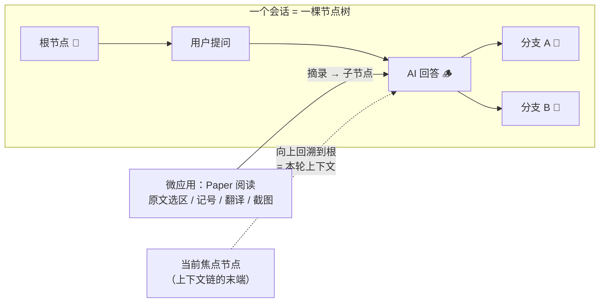

关键点：**上下文只取"当前焦点 → 根"这一条路径**，兄弟分支的内容不会混进来。
这是整个产品区别于普通聊天的根本。

### 1.3 总体取舍

- **纯前端单体**：没有自建业务后端。LLM 请求要么直连（BYOK / 社区版 token），要么走 Vite 开发代理隐藏 Key。
- **数据本地优先**：会话、文件夹、PDF 文件、截图全部存在浏览器 IndexedDB，不经过服务器。
- **微应用是窄接口**：微应用拿不到 store，只能通过主应用给的动作改动画布（见 §8.1）。

---

## 2. 技术栈

以 `package.json` 为准。

| 类别 | 技术 | 版本 |
|---|---|---|
| 框架 | React | ^19.2.4 |
| 语言 | TypeScript | ~5.9.3 |
| 构建 | Vite（rolldown） | ^8.0.1 |
| 状态 | Zustand | ^5.0.12 |
| 画布 | @xyflow/react（React Flow） | ^12.10.2 |
| 自动布局 | dagre | ^0.8.5 |
| LLM | openai（SDK）+ 原生 fetch（Anthropic 协议） | ^6.33.0 |
| Markdown | react-markdown + remark-gfm + remark-math + rehype-raw + rehype-katex | ^10.1.0 |
| Markdown→HTML | unified + remark-parse/remark-rehype/rehype-stringify | ^11.0.5 |
| PDF | pdfjs-dist | ^6.3.289 |
| DOCX 解析 | mammoth（动态 import） | ^1.12.3 |
| 图标 / 动画 / 样式 | lucide-react / framer-motion / Tailwind CSS 4 | — |

---

## 3. 总体架构

### 3.1 分层

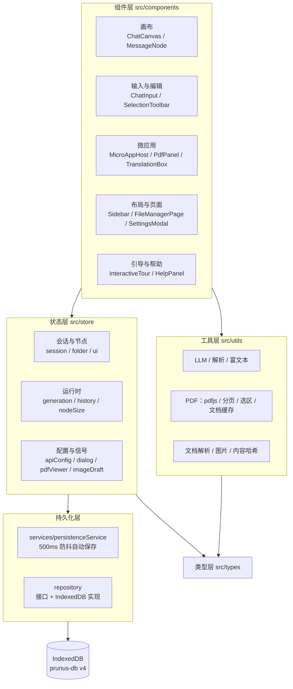

依赖方向是单向的：`components → store / utils → types`。
`utils` 原则上不认识组件；例外只有 `llmApi` 需要读取 `apiConfigStore` 里的连接参数。

### 3.2 运行时拓扑

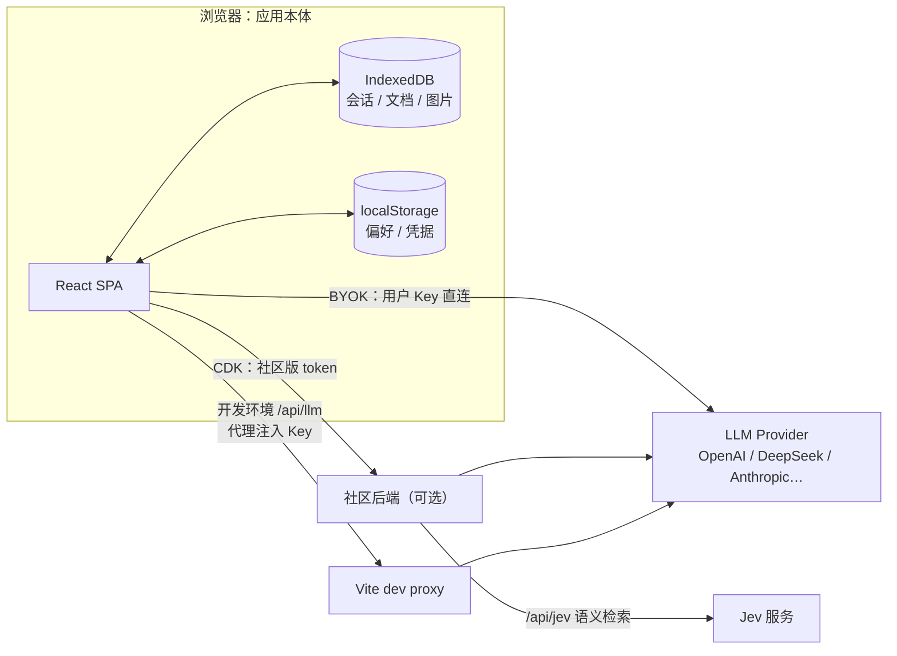

三种凭据模式由 `apiConfigStore.config.mode` 决定：

| 模式 | 何时出现 | 请求去向 |
|---|---|---|
| `unconfigured` | 首次启动、重置后 | 先尝试领免费额度（有社区后端时），失败则显示配置页 |
| `byok` | 用户填了自己的 Base URL + Key | 直连用户 provider |
| `cdk` | 领到免费 token 或兑换了兑换码 | 走社区后端（返回的 token 即 apiKey） |

### 3.3 依赖上的几条硬规则

- `store/historyStore` **不 import** `sessionStore`（会循环）；当前会话由调用方传入。
- `components/microapps/registry` 只依赖类型，不依赖面板实现；面板通过动态 `import()` 加载。
- `utils/pdfDocumentCache` 是模块级 LRU，不放进 store —— 它持有几 MB 的非序列化对象。
- 类型层不反向依赖任何实现。

---

## 4. 数据模型

### 4.1 实体关系

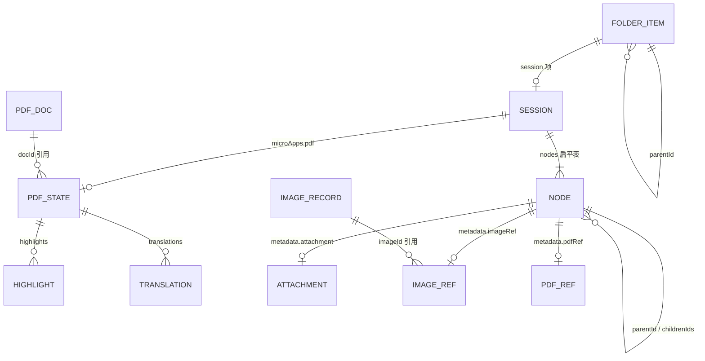

注意最后两条：**PDF 文件与截图二进制在独立的全局表里**，会话只存引用。
这是为了让「自动保存的整表重写」不必反复搬运几 MB 的二进制（见 §6）。

### 4.2 对话树

```ts
interface ChatSession {
  id: string;
  title: string;
  nodes: Record<string, PrunusNode>;  // 扁平存储，不是嵌套树
  rootNodeId: string | null;
  currentNodeId: string | null;       // 焦点 = 上下文链的末端
  globalPrompt?: string;              // 会话背景，追加到 system 提示词
  microApps?: SessionMicroApps;       // 目前只有 pdf
  createdAt: number;
  updatedAt: number;
}
```

- 树关系**双向记录**：`node.parentId` + `parent.childrenIds`。两边必须同时维护
  （`insertChildNode` / `deleteNode` 是仅有的两个入口）。
- 节点类型定义了九种（note/todo/…），**运行时只使用 `ai-chat`**，其余是预留。
- 节点标记：`🌱` 根、`🪵` 有分叉、`🍃` 叶子、`🍑` 手动重点。标记变化不影响语义，只影响外观与布局。
- 节点尺寸（`width/height`）与收缩状态（`collapsed`）也在节点上，参与画布布局。

### 4.3 `metadata` 扩展槽

所有"附加在节点上的东西"都走 `metadata: Record<string, unknown>`，**不新增节点字段**。
读取一律使用带守卫的 getter（metadata 可能来自导入的 JSON，脏数据不该让整棵树渲染崩掉）。

| Key | 类型 | 写入方 | 作用 |
|---|---|---|---|
| `attachment` | `NodeAttachment` | `ChatInput` | 上传文档解析出的纯文本（正文 + 文件名 + 类型 + 体积） |
| `pdfRef` | `NodePdfRef` | `sessionStore.addQuotedNode` | 摘录出处：docId / 页码 / 文件名 |
| `pdfQuote` | `true` | 同上 | 标记「正文是 PDF 原文摘录」→ **不走 Markdown 渲染** |
| `imageRef` | `NodeImageRef` | `ChatInput` | 截图引用：imageId / 尺寸 / 页码 / docId / 小缩略图 |

### 4.4 会话级微应用状态

```ts
interface PdfMicroAppState {
  docId: string;          // 内容哈希
  page: number;           // 上次读到第几页
  name?: string;          // 冗余存一份：换设备缺文件时还要能说清缺的是哪份
  pageCount?: number;
  highlights?: PdfHighlight[];   // 记号笔 + 已建节点标记
  translations?: PdfTranslation[]; // 译文白块
}
```

- **位置一律存归一化矩形**（页面宽高的 0–1 比例），缩放 / 换面板宽度 / 换设备都不用重算。
- `PdfHighlight` 的 `nodeId` 可缺省：没有 nodeId 的是"纯记号笔"，不可点击跳转、也不会因节点删除而消失。
- `PdfTranslation` 额外存 `sourceText` / `translatedText` / `fontRatio`（原文字号 ÷ 页面高度）。

### 4.5 全局内容库

| 表 | 主键 | 内容 | 是否随会话导出 |
|---|---|---|---|
| `pdfDocs` | `docId`（内容哈希） | PDF 文件本体 + 文件名 / 页数 | ❌ 只导出 docId 引用 |
| `images` | `imageId`（内容哈希） | JPEG 本体 + 尺寸 | ❌ 只导出 imageId 引用 |

内容哈希由 `utils/docHash.ts` 计算（优先 SHA-256，非安全上下文降级为 FNV-1a 64 位）。
同一份论文在两个会话里打开只存一份；换设备后重新上传同一文件可按 hash 自动重新关联。

---

## 5. 状态层

### 5.1 Store 一览

| Store | 管什么 | 持久化 | 键 |
|---|---|---|---|
| `useSessionStore` | 全部会话、节点、微应用状态 | IndexedDB（经 persistenceService） | — |
| `useFolderStore` | 文件夹树 | 同上 | — |
| `useAPIConfigStore` | 凭据、模型、协议、视觉配置 | localStorage + IndexedDB | `prunus-api-config` |
| `useUIStore` | 页面、侧边栏、选择模式、微应用开关、引导 | localStorage（仅部分字段） | `prunus-ui-storage` |
| `useGenerationStore` | 流式内容暂存、生成态 | ❌ 内存 | — |
| `useHistoryStore` | 撤销 / 重做快照栈 | ❌ 内存 | — |
| `useNodeSizeStore` | 节点实测尺寸（rAF 批量提交） | ❌ 内存 | — |
| `useDialogStore` | confirm / prompt / toast | ❌ 内存 | — |
| `usePdfViewerStore` | 「跳到某页」的跨组件信号 | ❌ 内存 | — |
| `useImageDraftStore` | 待发送的截图草稿 | ❌ 内存 | — |
| `useChatStore` | **向后兼容门面**（@deprecated） | — | — |

`useUIStore` 的 `partialize` 只持久化引导相关字段与偏好，**不持久化**选择模式、微应用开关等瞬态 UI 状态。

### 5.2 状态该放哪：四条判断

1. **要跟着对话走 → 放会话**（`session.microApps`、`globalPrompt`）。切会话就是切它。
2. **要跨设备、要能撤销 → 放会话的持久化字段**，不要放组件 state。
3. **高频、只影响一个组件 → 放组件 state**（流式文本进 `generationStore`，因为它只被当前节点消费）。
4. **二进制 → 放独立 IndexedDB 表**，节点上只留引用与缩略图。

### 5.3 撤销 / 重做

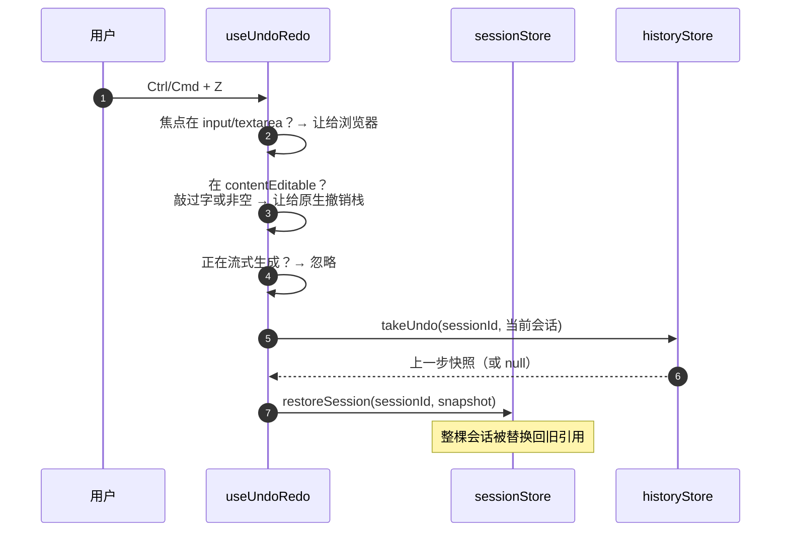

- 历史里存的是 **`ChatSession` 的快照引用**，不做深拷贝：sessionStore 全程不可变更新，
  旧引用本身就是完整快照，结构共享让一步历史只占"变化路径"的内存。
- `pushHistory(get)` 由会改节点树的 action 调用；`focusNode`、翻页、换文件**刻意不记**。
- 特例：`setSessionMicroApp` 只在 **highlights / translations 数组引用变化**时记一步 ——
  翻页写的是 `{...latest, page}`，两个数组都还是原来的引用。
- 500ms 时间窗合并：一次操作触发的多次写入合成一步；最多保留 50 步。
- 进行中的翻译**不写入 store**（只在组件态），成功后落库 —— 否则撤销会撤出一个空壳。
- 键盘分流规则见 §11 第 6 条。

---

## 6. 持久化

### 6.1 IndexedDB

数据库：`prunus-db`，**版本 4**。每个 store 的创建都有 `contains` 守卫，老用户升级不丢数据。

| Object store | keyPath | 索引 | 说明 |
|---|---|---|---|
| `sessions` | `id` | createdAt / updatedAt | 会话（节点内嵌） |
| `nodes` | `id` | sessionId / createdAt | **已建但未使用** |
| `settings` | `key` | — | 目前只存 `apiConfig` |
| `folders` | `id` | parentId / createdAt | 文件夹项 |
| `pdfDocs` | `docId` | — | PDF 文件本体 |
| `images` | `imageId` | — | 截图 JPEG 本体 |

### 6.2 自动保存

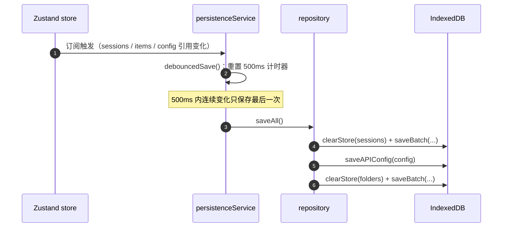

**这是全量重写，不是增量。** 它带来两个直接后果，改代码时必须记住：

1. 任何一次会话改动都会重写**全部会话**与**全部文件夹项**；
2. 所以 `pdfDocs` 与 `images` **绝不能**混进 `saveAll` —— 否则改一个节点就要重写几十 MB 图片。

### 6.3 导出 / 导入边界

| 数据 | 全量导出 `exportToJSON` | 单会话导出 `serializeSession` | 说明 |
|---|---|---|---|
| 会话与节点 | ✅ | ✅ | |
| 文件夹项 | ✅ | ❌ | |
| API 配置 | ✅ | ❌ | 全量导出也带凭据，提醒用户 |
| PDF 二进制 | ❌ | ❌ | 只留 docId |
| 截图二进制 | ❌ | ❌ | 只留 imageId |

单会话导入采用**追加合并**：冲突时重命名为「（导入）」副本，绝不覆盖本地数据。

---

## 7. 对话主流程

### 7.1 启动与配置闸门

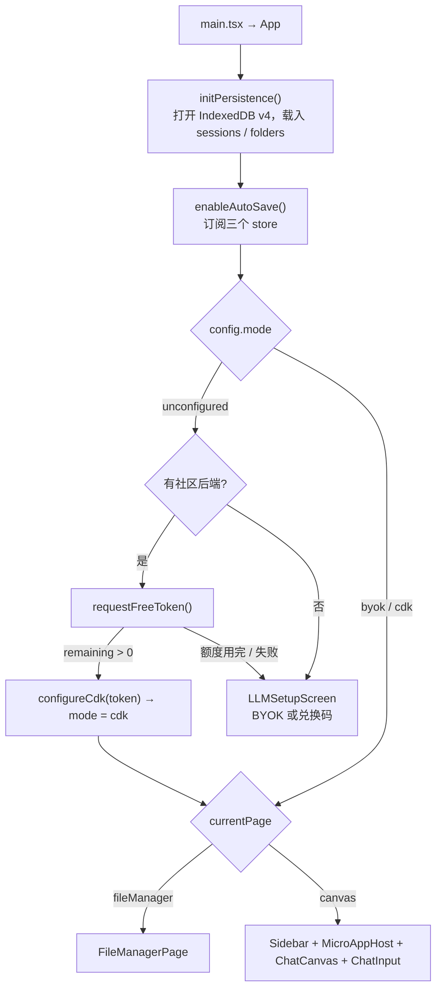

### 7.2 一条消息的完整生命周期

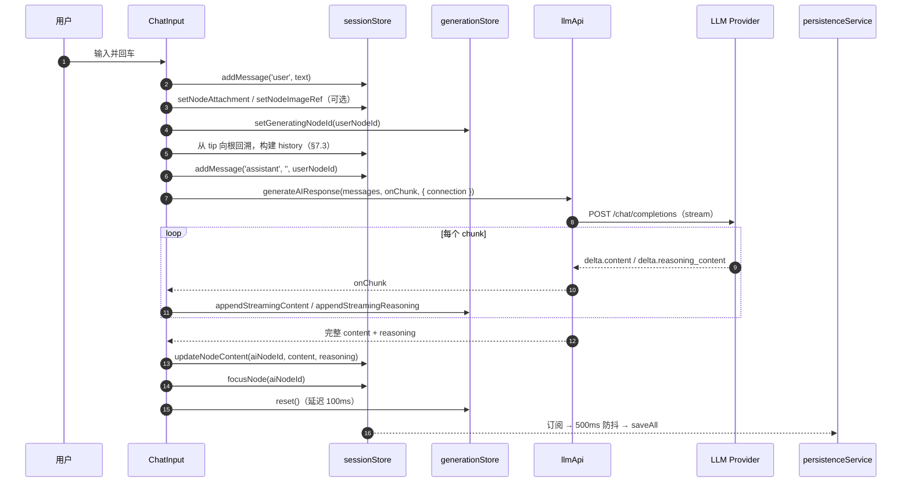

设计要点：**流式内容先进 `generationStore`，结束后一次性写入 `sessionStore`**。
否则每个 chunk 都会触发整棵树的 dagre 布局重算。

### 7.3 上下文链与注入规则

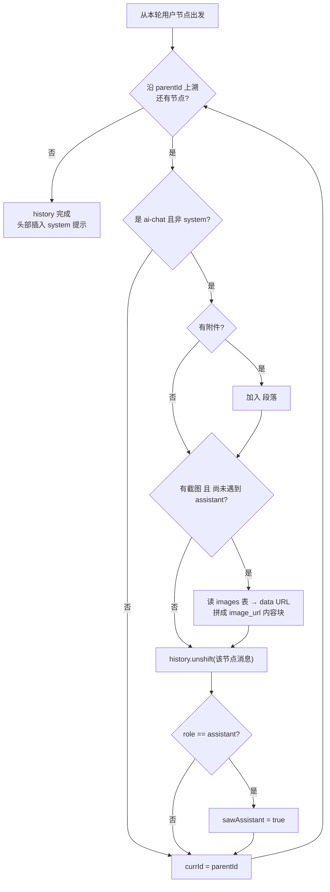

两条注入规则都是**为控制无状态 API 的重复成本**而设计的：

| 内容 | 规则 | 原因 |
|---|---|---|
| 附件文本 | 沿**整条祖先链**注入 | 模型无状态；只注入当前节点的话，追问时它会"忘了"文档 |
| 截图 | 只在该节点到 tip 之间**还没有 assistant** 时注入 | 一旦有了回答，回答正文已在链里；再发图等于每轮都付一次视觉 token |

`htmlToPlainText` 会把画布上编辑过的 HTML 摊平成纯文本再发出去 —— 原样发 HTML 既费 token 又是噪音。

### 7.4 流式渲染

`MarkdownText` 的 `streaming` 模式把内容切成「已定稿的块 + 正在写的尾巴」：

- 已定稿的块各自解析一次，之后被 `memo` 住；
- 只有尾巴每个 chunk 重解析；
- 总开销从 O(n²) 降到 O(n)（16k 字实测：45 秒主线程 → 0.6 秒）。

切分规则全部取保守：列表 / 引用 / 表格 / 缩进代码块跨空行、代码围栏内、`$$` 公式内、
以及含原始 HTML 的块都**不切**。正确性由"逐前缀等价"验证。

### 7.5 Branch Out

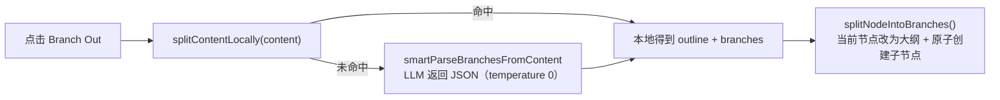

本地优先是因为基于正则的拆分**便宜且确定**；只有识别不出来时才花一次 LLM 调用。

### 7.6 编辑、选区浮条与摘取

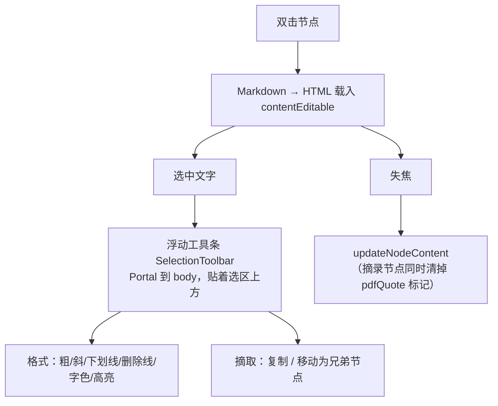

- 浮条只依赖 `Selection`/`Range`，编辑态与展开视图（`ExpandedView`）共用同一个组件。
- 摘取会**改写源节点内容并创建兄弟节点**，属于两次写入，必须与节点操作一起被撤销合并（§5.3）。
- 右键菜单仍保留摘取入口（与浮条并存），但主路径是浮条。

### 7.7 节点搜索

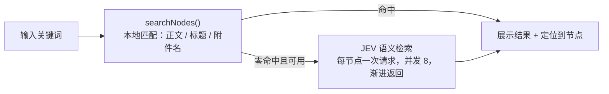

JEV 依赖社区后端（`hasCommunityBackend()`），没有后端时整条路径不存在，界面也不显示入口。

---

## 8. 微应用架构

> 这是最近增长最快、也最容易被改坏的部分。

### 8.1 定位与边界

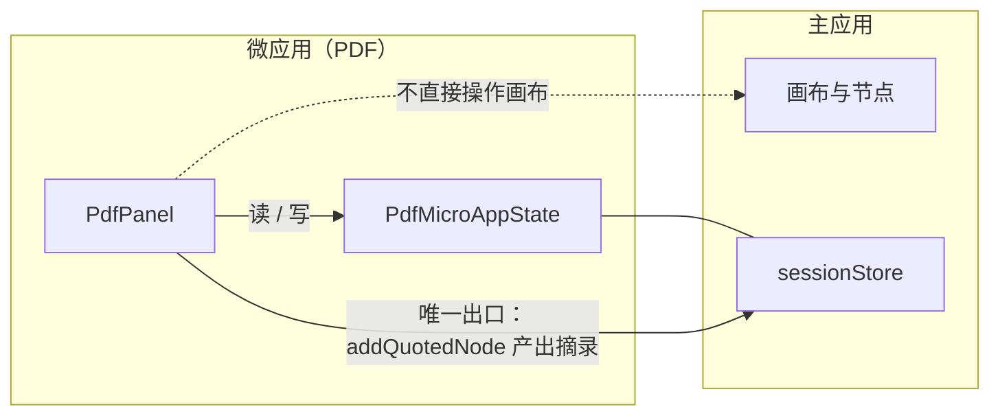

三条边界（来自 `types/microApp.ts` 的注释，改之前先读）：

1. **状态属于会话，不属于应用**：切会话切的就是这里读到的文档。
2. **微应用不"操作"主应用**：它只产出一段摘录（原文 + 出处），把摘录变成什么节点由主应用决定。
3. **没有插件系统**：`registry.tsx` 是一张长度为 1 的表；加第二个微应用是"加一行"，
   但刻意不做沙箱、第三方加载、权限模型 —— 只用一个例子设计出来的扩展接口几乎一定是错的。

### 8.2 宿主与生命周期

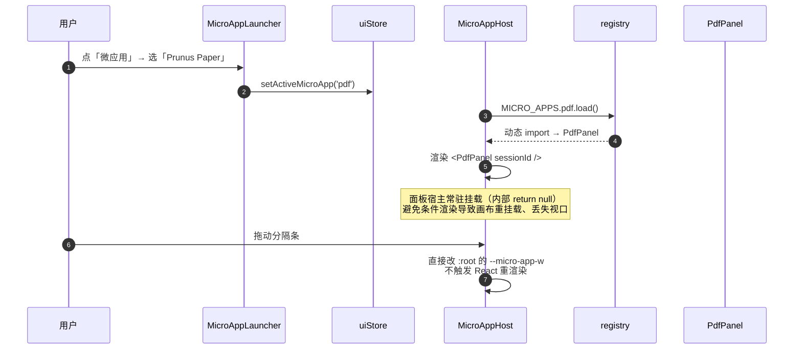

- 面板宽度存在 `uiStore.microAppWidth`，渲染时写进 CSS 变量 `--micro-app-w`；
  拖动过程中**只改变量**，等松手再写 store。
- 窄屏（`MIN_VIEWPORT_PX` 以下）打开微应用会自动收起，靠 `matchMedia` 监听。

### 8.3 PDF 面板的分层渲染

一个页面由四层叠成（全部绝对定位在同一个 `[data-page]` 容器里，坐标是页面比例）：

```
┌─ [data-page] 页面容器（宽高 = 页面尺寸 × 缩放）────────────────┐
│                                                              │
│  z-3  译文层      TranslationBox：白底矩形 + 译文文字 + 悬停按钮 │
│  z-2  记号笔层    highlights：不透明色块，整层 opacity + multiply │
│  z-0  文本层      .pdf-text-layer：透明真文字，负责"被选中"       │
│  —    canvas      pdf.js 渲染的像素                             │
└──────────────────────────────────────────────────────────────┘
```

为什么必须分层：

- **canvas 只是像素**，上面没有可选中的文字；文本层是叠上去的透明真文字，
  按每个字的坐标摆放，负责被拖选。
- 记号笔与译文都必须**高于文本层**，否则会被透明文字压住；译文还要高于记号笔。
- 记号笔与选中高亮都踩过同一个坑：**逐块半透明会在行盒重叠处叠两次**，
  所以颜色一律不透明，透明度放在整层（见 §11 第 8 条）。

页面挂载是虚拟化的：根据累计高度算出可视区间（上下各预挂载 1400px），
只挂区间内的页；高度先估算、渲染后由 `onMeasured` 修正。

### 8.4 打开一份 PDF

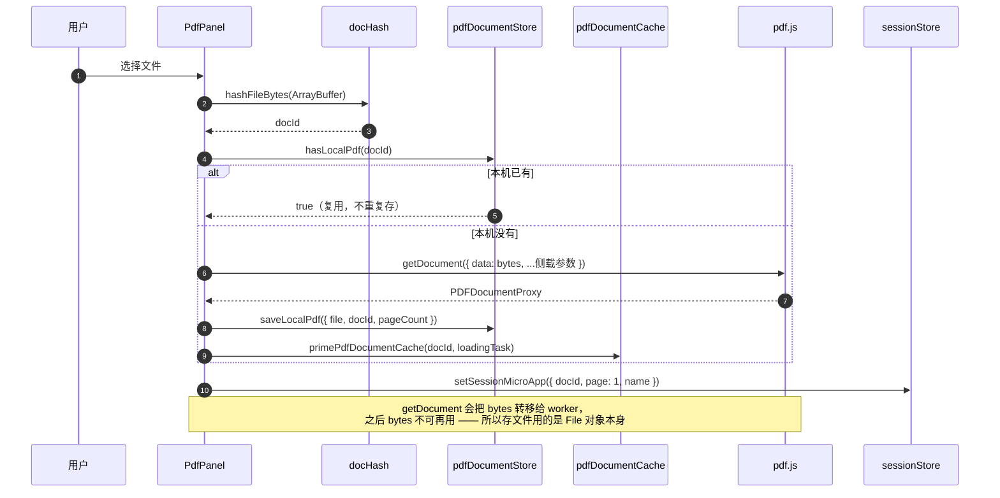

已解码文档由 `pdfDocumentCache` 缓存（LRU，最多 3 份，引用计数为 0 才可淘汰）。
面板挂载时 `acquire`、卸载时 `release`；切换会话再切回来不必重新解码。
释放必须走 `loadingTask.destroy()`，`PDFDocumentProxy.cleanup()` 不够。

### 8.5 选区动作总览

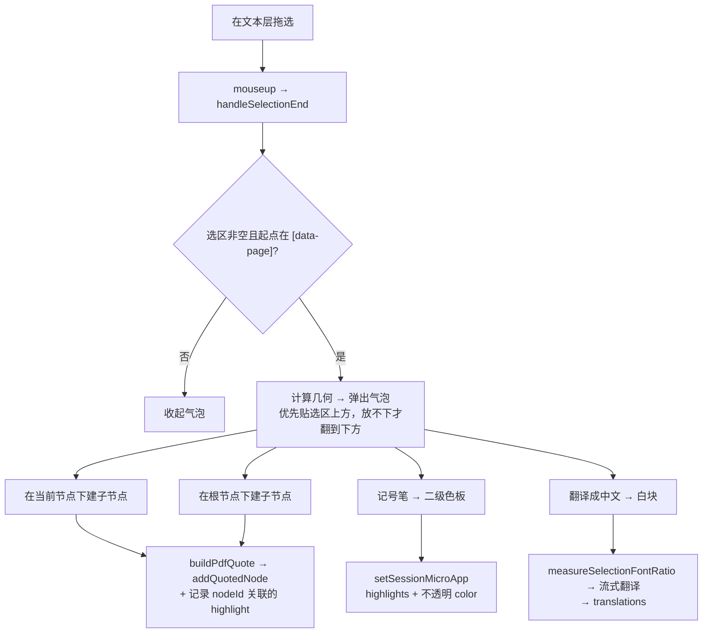

气泡的收起依赖两条信号：滚动容器的 `mouseup`（正常拖选）与
document 的 `selectionchange`（选区被收成光标）。只有前者不够 —— 在已选中的文字上再点一下时，
浏览器可能**先触发 mouseup、后收起选区**，那次 mouseup 读到的还是旧选区，会把气泡原样重建。

### 8.6 摘录建节点

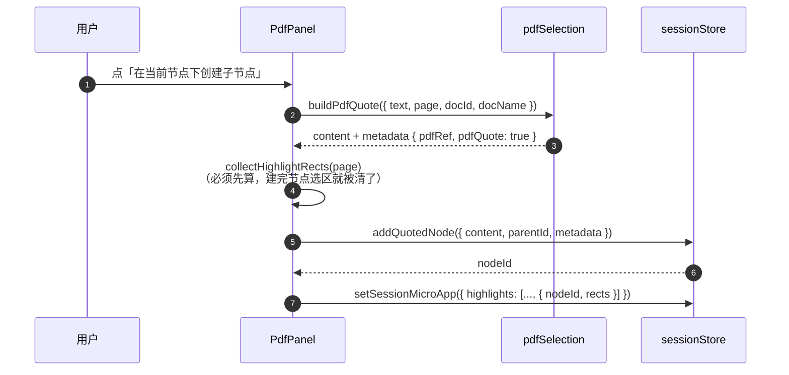

- 摘录正文**原样保留**，做 Markdown 转义反而会让节点里出现反斜杠，与用户选中的原文不一致。
- `pdfQuote` 标记让节点正文**不走 Markdown 渲染**：文档文字是不可信输入，
  而渲染管线带 `rehypeRaw`，会把正文当 HTML 解析。
- 用户手动编辑该节点后会清掉 `pdfQuote` 标记，节点回到普通渲染路径。
- 单次摘录上限 4000 字：摘录会随祖先链在之后每一轮重复发送，误选整页 = 每轮都付这份成本。

### 8.7 记号笔

- 与摘录共用同一套几何（归一化矩形）与渲染层，区别是**可以没有 nodeId**。
- 没有 nodeId 的标记：不可点击、不随节点删除消失，纯粹是阅读标注。
- 有 nodeId 的标记：按住 Ctrl/Cmd 时变为可点击（手型光标），点一下在画布上聚焦对应节点。
  **默认不拦截鼠标事件**，否则已标记区域里就选不了字了。
- 整层 `mix-blend-mode: multiply` + `opacity`，颜色本身不透明（§11 第 8 条）。

### 8.8 翻译（涂改液）

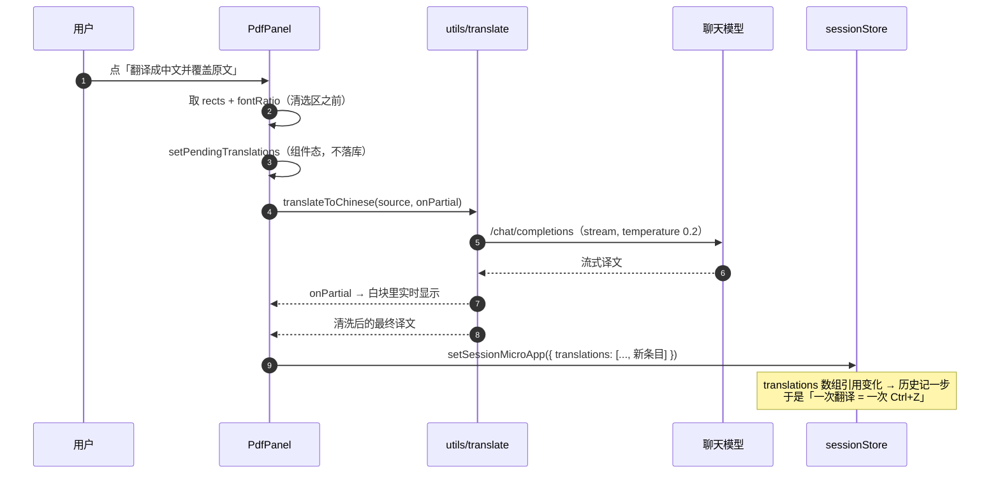

排版约束（观感全靠这几条，改之前先读 `TranslationBox`）：

1. **白底分两层**：页面层按**精确选区矩形**铺白（只盖选中的行），文字再带一层 inline 白底。
   只铺外接框会盖掉最后一行没选中的尾巴；只靠文字白底，行距缝隙里会漏出原文。
2. **字号取原文真实字号**：翻译时从文本层 span 读 pdf.js 算好的 `font-size`，
   存成 `fontRatio`（÷ 页面高度）；渲染时再乘 0.8 的中日文视觉修正。
3. **只缩不撑**：放不下时二分缩字号（下限 0.7），仍放不下就裁切 + 渐隐 + 「展开」。
   绝不撑大白块去迁就译文 —— 那会盖住用户没选的字。
4. **命中范围只到文字**：容器 `pointer-events: none`，只有文字与悬停按钮吃事件。
5. 「按住查看原文」是临时状态（`peekingId` 在 `PdfPageView`），必须**连白底一起撤掉**。

翻译复用主聊天模型，**没有独立配置项**；译文存会话，随导出走（纯文本，不像二进制）。

### 8.9 截图问答

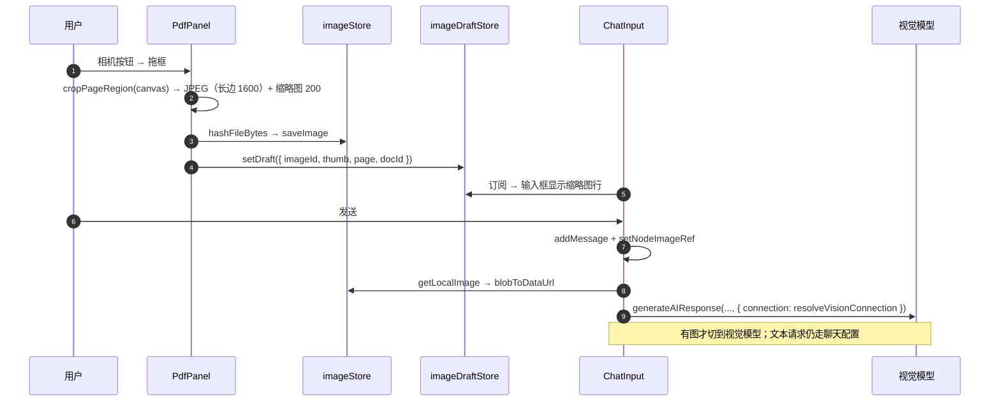

- 截图直接**裁 pdf.js 渲染好的 canvas**，不是对 DOM 截图 —— 不会把文本层、记号笔、选区一起拍进去。
- 图片**不进每轮上下文**（§7.3）；换设备后图片缺失会明确提示，而不是静默少发一张图。
- 节点卡片只显示缩略图；点击打开 `ImageLightbox`（Portal 到 body，覆盖画布区域）。

### 8.10 键盘作用域隔离

微应用面板必须把全局快捷键"挡下来"，否则会静默删数据：
PDF 文本层是普通 `<div>`，拖选文字不会让任何元素获得焦点（`activeElement` 仍是 body），
画布的 Delete / 方向键守卫会全部通过。

`utils/microAppFocus.ts` 用**两个判据**判断是否该让路：

```ts
焦点在面板内  ||  当前非空选区的锚点在面板内
```

撤销/重做是例外：它是全局动作，用户刚在 PDF 上画完记号（焦点还在面板里）时恰恰最需要它。

---

## 9. LLM 接入层

### 9.1 连接解析

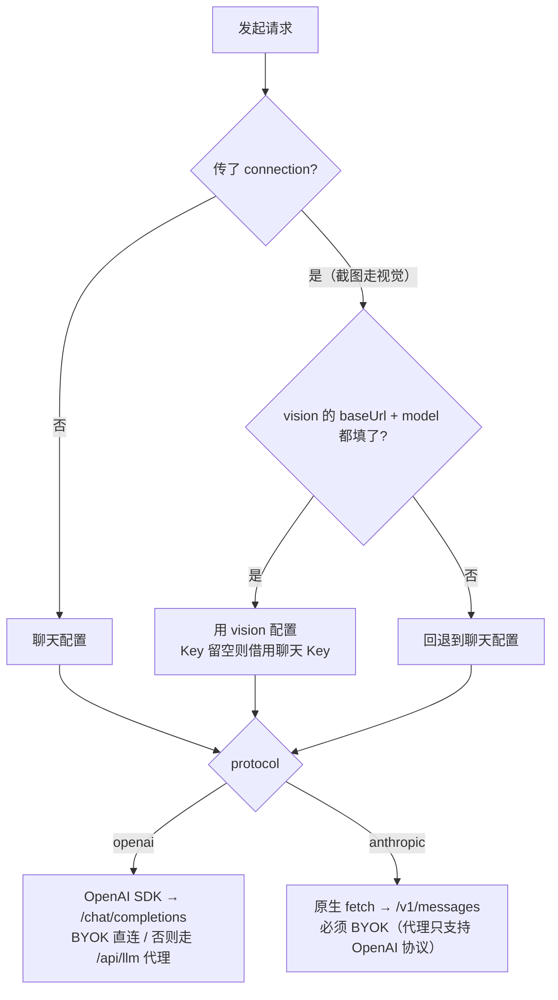

### 9.2 协议与多模态

- 内容既可以是 `string`，也可以是内容块数组（OpenAI/DeepSeek 形状）。
- 带图时统一构造 `{ type: 'image_url', image_url: { url: dataUrl } }`；
  走 Anthropic 协议时由 `toAnthropicContent` 转换成 `{ type: 'image', source: { type: 'base64', ... } }`。
  不转的话，用户切到 Anthropic 后带图请求会被端点直接拒绝。
- `enableThinking` 映射为 GLM-5 的 `thinking: { type }`；不传则用模型默认。
- Safari 会额外带 Accept 头（历史兼容）。

### 9.3 错误与额度

| 状态 | 处理 |
|---|---|
| 网络 / 连接 | 提示检查代理与 `.env.local` |
| 401 | API Key 无效 |
| 402 | `QuotaExceededError`；CDK 模式会清掉本地配置，让配置闸门重新接管 |
| 404 | 模型不存在 |
| 403 | Safari 相关提示 |

一次对话请求失败时，错误会作为一条 `system` 子节点写进链路，用户看得见。

### 9.4 非对话调用

| 调用 | 入口 | 连接 |
|---|---|---|
| 分支拆分 | `utils/aiParser.ts` | 主配置，temperature 0，关思考 |
| 会话总结 | `utils/summarize.ts` | 主配置 |
| 选区翻译 | `utils/translate.ts` | 主配置，temperature 0.2 |
| 截图问答 | `ChatInput` | **视觉配置**（未配置则回退主配置） |

这些调用都**不属于任何对话链路**，不写节点、不参与上下文。

---

## 10. 界面结构与页面状态

### 10.1 布局

```mermaid
flowchart LR
  App["App"] --> Sidebar["Sidebar<br/>文件夹树 / 设置 / 帮助"]
  App --> Host["MicroAppHost<br/>常驻；无微应用时 return null"]
  App --> Main["main：顶栏 + 画布"]
  Main --> Top["面包屑 / 会话标题"]
  Main --> RF["ReactFlowProvider"]
  RF --> EV["ExpandedView（展开态）"]
  RF --> CC["ChatCanvas（画布态）"]
  Main --> CI["ChatInput"]
  App --> Overlays["SettingsModal / HelpPanel / InteractiveTour / DialogHost"]
```

微应用打开时，`main` 的 `left` 让到 `var(--micro-app-w)`；侧边栏变成浮层盖在面板之上 ——
微应用跟对话走，所以要允许用户在面板开着时切会话。

### 10.2 页面状态机

页面不是 URL 路由，而是 `uiStore.currentPage` 驱动的条件渲染。

```mermaid
stateDiagram-v2
  [*] --> fileManager
  fileManager --> canvas: 打开会话
  canvas --> fileManager: 面包屑 / Logo
  canvas --> expanded: 叶子节点「展开」
  expanded --> canvas: 返回 / Esc
```

设置、帮助、引导、对话框都是覆盖层，不改变页面状态。

### 10.3 引导

`InteractiveTour` 有 15 个步骤、5 个阶段（文件管理 → 画布 → 发消息 → 节点导航 → 高级功能）。
首访自动启动（延迟 1s），中断后可续；完成状态与统计存在 `uiStore`（localStorage）。
步骤验证通过订阅 store 变化判断，不依赖点击事件本身。

---

## 11. 结构性约束

以下每一条都是"踩过坑之后定下来的"，改代码前先读。

1. **持久化是全量重写**：`saveAll` 先 `clear` 再 `saveBatch`。任何一次会话改动都会重写全部会话与文件夹。
   二进制（PDF / 图片）必须留在独立表里，绝不进 `saveAll` 与 JSON 导出。
2. **不可变引用是承重结构**：大量逻辑用"引用变没变"判断是否重渲染 / 是否持久化 / 是否记历史。
   读-改-写必须在一次 `set` 里完成；返回原 state 引用是显式的"跳过"信号。
3. **编辑器里的 Ctrl+Z 要分流**：焦点在 contentEditable 且敲过字（`data-editor-dirty=true`）
   或内容非空时，让给浏览器原生撤销栈；只有"空的、从未输入过"才接管（对应"新增节点后自动进编辑态"）。
   `dirty` 是**粘性**的，直到重新进入编辑态才复位。
4. **流式内容不进 sessionStore**：高频写入会触发整树布局重算。先写 `generationStore`，结束后一次性落库。
5. **微应用拿不到 store**：它只能读写会话上的 `microApps`，通过 `addQuotedNode` 产出摘录。
6. **全局快捷键要让路给微应用面板**：判据是"焦点或选区在面板内"，缺一不可（§8.10）。
7. **PDF 位置一律归一化**：`[x, y, w, h]` 都是页面宽高的比例；像素只用于字号这类需要屏幕尺寸的量。
8. **半透明叠色由整层控制**：逐块 rgba 会在行盒重叠处叠两次，出现横条纹接缝。
   颜色不透明 + 整层 `opacity`；记号笔再加整层 `multiply`。
9. **`getDocument` 会转移 ArrayBuffer**：交给 pdf.js 之前必须先存文件（用 File 对象本身）。
10. **严格模式（StrictMode）会模拟卸载**：挂载/卸载清理里改全局状态前，先确认自己不是被"假卸载"触发的
    （典型症状：新建节点后编辑态被立刻清掉）。
11. **Portal 到 body**：任何 `position: fixed` 的浮层，只要祖先里有 `transform`（React Flow 画布、
    输入框的 `-translate-x-1/2`），定位基准都会变成那个祖先。
12. **`position: fixed` + 拖拽用 ref 直接写样式**：拖动期间逐帧 `setState` 会掉帧，面板渲染一次要遍历全部页。
13. **元数据读取一律带守卫**：`metadata` 可能来自导入的 JSON，脏数据只该让一个角标不显示，不该让整棵树崩掉。
14. **图片不进每轮上下文**：规则见 §7.3，靠 `sawAssistant` 无状态判断，不要加"已发送"标记
    （请求失败时那种标记会错乱）。

---

## 12. 技术债与未使用代码

基于源码检查，当前仍存在：

| 项 | 说明 |
|---|---|
| `useChatStore` 门面 | 标注 @deprecated，但 `ChatInput` / `MessageNode` 仍在用它调用部分 action |
| 未使用依赖 | `@dnd-kit/*` 三个包在 `package.json` 中但源码无引用 |
| 未使用组件 | `onboarding/WelcomeGuide.tsx`、`onboarding/ContextualHint.tsx` |
| 未使用 Hook | `hooks/useTourStepValidator.ts`（逻辑与 `TourOverlay` 重复） |
| 未使用工具 | `richtext.ts` 的 `handlePasteAsPlainText` / `sanitizeHTML` |
| 未使用文件 | `src/App.css`（Vite 模板遗留，未导入） |
| 未使用表 | IndexedDB 的 `nodes` 表已建但节点内嵌在 session 中 |
| 类型预留 | `types/node.ts` 定义了九种节点类型，运行时只用 `ai-chat` |
| 两套导出 | 全量 `exportToJSON` 与单会话 `serializeSession` 的字段范围不同，注意别混用 |

---

## 13. 开发、部署与验证

### 13.1 本地开发

```bash
npm install
npm run dev      # predev 会先把 pdfjs 侧载资源复制到 public/pdfjs/
npm run build    # tsc -b + vite build
npm run lint
```

- PDF 侧载资源（cmaps / standard_fonts / wasm）由 `scripts/copy-pdfjs-assets.mjs` 复制。
  **直接跑 `vite` 而不跑 `npm run dev` 会缺这些资源**，表现是中文 PDF 变方块、老论文整页空白。
- 环境变量走 `.env.local`（gitignored）：`LLM_BASE_URL` / `LLM_API_KEY` / `LLM_MODEL` / `ENABLE_THINKING` /
  `COMMUNITY_API`。其中只有 "未配置时走代理" 这一条路径用到它们；应用运行时的实际配置来自
  `apiConfigStore`（localStorage），两者不要混淆。
- `vite.config.ts` 的代理顺序有讲究：`/api/tencent` 与 `/api/llm` 必须写在 `/api/` 之前 ——
  Vite 按书写顺序匹配前缀，宽泛的 `/api/` 会把它们一起吃掉。
- 生产构建的 `base` 由 `BASE_URL` 决定（默认生产为 `/app/`）。

### 13.2 部署

`ecosystem.config.cjs` + `start.sh` / `stop.sh` / `restart.sh` / `logs.sh` 用 PM2 托管 `npm run dev`。
注意 `watch: false`：改代码后需要 `./restart.sh`，不会自动热更。

### 13.3 驱动真实应用做验证

仓库没有测试基础设施，验证一律把应用跑起来。用 Playwright + 本机 Edge 即可，
但需要先过三道闸门：

1. **配置闸门**：`localStorage['prunus-api-config']` 里 `mode` 不能是 `unconfigured`。
2. **引导闸门**：`localStorage['prunus-ui-storage']` 里 `tourState.completedAt` 非空，
   否则引导遮罩会拦截点击。
3. **进入画布**：点击 `[data-tour="example-file"]` 载入示例会话。

微应用的入口是 `button[title="打开微应用"]`，列表项按 `title` 匹配（`Prunus Paper`），
不是 `label`（`PDF`）。PDF 文件用 `setInputFiles` 灌到 `input[type=file][accept*="pdf"]`。

---

## 14. 文件索引

```
src/
├── App.tsx                     应用根组件：初始化、配置闸门、页面切换、布局
├── main.tsx                    React 挂载入口（StrictMode）
├── types/
│   ├── node.ts                 节点模型、类型守卫、attachment / imageRef
│   ├── session.ts              会话模型与摘要
│   ├── folder.ts               文件夹模型与树构建
│   ├── microApp.ts             微应用状态、PdfHighlight / PdfTranslation、PDF 引用标记
│   ├── image.ts                截图记录
│   └── tour.ts                 引导步骤与状态
├── store/
│   ├── sessionStore.ts         会话与节点（含 pushHistory、restoreSession）
│   ├── folderStore.ts          文件夹树 CRUD
│   ├── uiStore.ts              页面 / 布局 / 选择模式 / 微应用开关 / 引导
│   ├── apiConfigStore.ts       凭据、协议、视觉配置、resolveVisionConnection
│   ├── generationStore.ts      流式内容暂存
│   ├── historyStore.ts         撤销 / 重做快照栈
│   ├── nodeSizeStore.ts        节点实测尺寸（rAF 批量）
│   ├── dialogStore.ts          confirm / prompt / toast
│   ├── pdfViewerStore.ts       「跳到某页」跨组件信号
│   ├── imageDraftStore.ts      待发送截图草稿
│   └── chatStore.ts            @deprecated 兼容门面
├── services/persistenceService.ts  初始化、防抖自动保存、导入导出、清空
├── repository/                 仓储接口 + IndexedDB 实现
├── utils/
│   ├── llmApi.ts               LLM 调用、协议转换、连接覆盖
│   ├── aiParser.ts             Branch Out 的 LLM 兜底
│   ├── contentSplit.ts         本地结构化拆分
│   ├── summarize.ts            会话总结
│   ├── translate.ts            选区翻译
│   ├── documentParser.ts       附件解析（text / docx / pdf），token 与体积上限
│   ├── richtext.ts             富文本、选区、HTML→纯文本
│   ├── markdown.ts              Markdown 归一化
│   ├── markdownSegments.ts     流式 Markdown 分段
│   ├── layout.ts               dagre 自动布局
│   ├── nodeSize.ts             节点尺寸常量与解析
│   ├── nodeSearch.ts           本地关键字检索
│   ├── jevClient.ts            JEV 语义检索（需社区后端）
│   ├── sessionTransfer.ts      单会话导出 / 导入
│   ├── docHash.ts              内容哈希（SHA-256 / FNV-1a 降级）
│   ├── pdfjs.ts                pdf.js 统一引导（worker + 侧载资源）
│   ├── pdfPaging.ts            连续滚动的分页几何
│   ├── pdfSelection.ts         选区 → 摘录（截断 / 乱码检测）
│   ├── pdfDocumentStore.ts     pdfDocs 表薄封装
│   ├── pdfDocumentCache.ts     已解码文档 LRU（引用计数）
│   ├── imageStore.ts           images 表薄封装 + blob→dataURL
│   ├── microAppFocus.ts        键盘作用域判定
│   ├── indexedDB.ts            数据库封装（v4）
│   └── cdkService.ts           社区后端：免费额度 / 兑换 / 额度查询
├── hooks/
│   ├── useUndoRedo.ts          撤销 / 重做快捷键
│   └── useTourStepValidator.ts 未使用
├── components/
│   ├── canvas/ChatCanvas.tsx   画布、自动布局、键盘导航、选择模式、按钮组
│   ├── canvas/MessageNode.tsx  节点卡片、编辑、浮条、摘取、缩放、角标
│   ├── canvas/NodeSearchBar.tsx 节点搜索（本地 + JEV）
│   ├── chat/ChatInput.tsx      输入、附件、截图、上下文构建、流式请求
│   ├── common/SelectionToolbar.tsx 选区浮条（格式 + 摘取）
│   ├── common/ImageLightbox.tsx    截图预览
│   ├── expanded/ExpandedView.tsx   链路编辑视图
│   ├── layout/                 Sidebar / SettingsModal / DialogHost / GlobalPromptModal
│   ├── pages/FileManagerPage.tsx   文件管理页
│   ├── setup/LLMSetupScreen.tsx    配置闸门页
│   ├── summary/SummaryModal.tsx    节点总结
│   ├── microapps/
│   │   ├── registry.tsx        微应用清单（动态 import）
│   │   ├── MicroAppHost.tsx    宿主：面板容器 + 分隔条 + 焦点作用域
│   │   ├── MicroAppLauncher.tsx 右上角入口
│   │   └── pdf/
│   │       ├── PdfPanel.tsx        顶栏、滚动分页、选区气泡、截图、翻译编排
│   │       ├── PdfPageView.tsx     canvas + 文本层 + 记号笔层 + 译文层
│   │       ├── TranslationBox.tsx  译文白块、字号拟合、悬停工具条
│   │       └── pdfTextLayer.css    文本层与选中样式
│   ├── markdown/MarkdownText.tsx   统一 Markdown 渲染（含流式分段）
│   └── onboarding/             引导、帮助、完成弹窗
└── index.css                   主题色、画布纹理、Markdown prose、滚动条
```

---

*本文档与代码同步维护。若发现不一致，以代码为准，并顺手修正本文。*
